# Entity Relationship Diagram (実体関連図)

| テーブル名                  | 説明                                                                             |
| :------------------------ | :------------------------------------------------------------------------------ |
| `users`                   | ユーザーの基本プロフィール情報を保持する。アカウント削除で、操作者の置き先になる「削除済みの利用者」(`00000000-0000-4000-8000-000000000001`。対応する`auth.users`の行はサインインできない)の1行を持つ |
| `rounds`                  | アーチェリーの記録単位となる「ラウンド」（1回の練習・試合セッション）を表す。距離構成は`distances`が持つ |
| `round_users`             | ラウンドの参加者の役割(射つ人`owner`・代理の人`editor`)と射手(番号)を持つ。利用者に紐づかない射手の行は利用者も役割も持たない |
| `distances`               | ラウンド中に射撃する特定の距離（70m、50m等）を表す。1ラウンドに複数の距離を持てる            |
| `shots`                   | 1行が1つのマス(距離・エンド・マスの番号)の矢で、点数・射手を記録する。矢はマスで識別し、マスの番号が射順である。1つのマスの行は1つだけである |
| `round_events` | `rounds`への変更を表す追記専用イベントログ。書き込みの正。削除・修正は行わない。効かせた操作の、効いた項目だけを記録する |
| `distance_events` | `distances`への変更を表す追記専用イベントログ。書き込みの正。削除・修正は行わない。効かせた操作の、効いた項目だけを記録する |
| `shot_events` | `shots`への変更を表す追記専用イベントログ。書き込みの正。削除・修正は行わない            |
| `target_faces`            | 的を表す。                                                                                 |
| `target_face_spots`       | 的の中の的中スポット（中心座標）を表す。1つの的が複数スポットを持てる（3つ目等の複数的配置）   |
| `target_face_rings`       | スポットの中の点数帯（同心円1本）を表す。半径・色・重なり順・得点を持つ                    |
| `preset_rounds`           | ラウンドの定型フォーマット（種別・弓種・距離構成）を表す。`owner_id`がnullならグローバル、値があれば個人プリセット |
| `preset_distances`        | `preset_rounds`が持つ距離構成の1行を表す                                             |

---

```mermaid
erDiagram
    users ||--o{ round_users : "1対多"
    rounds ||--o{ round_users : "1対多"
    rounds ||--o{ distances : "1対多"
    distances ||--o{ shots : "1対多"
    round_users ||--o{ shots : "射手"
    round_users ||--o{ shot_events : "射手"
    distances ||--o{ shot_events : "1対多"
    target_faces ||--o{ target_face_spots : "1対多"
    target_face_spots ||--o{ target_face_rings : "1対多"
    target_faces ||--o{ distances : "1対多"
    users ||--o{ preset_rounds : "1対多（owner）"
    preset_rounds ||--o{ preset_distances : "1対多"
    target_faces ||--o{ preset_distances : "1対多"
    users ||--o{ round_events : "1対多"
    users ||--o{ distance_events : "1対多"
    users ||--o{ shot_events : "1対多"

    users {
        uuid id PK "auth.users.idと同一。認証基盤側のアカウントと1対1対応"
        string name "表示名"
        timestamp created_at "作成時刻"
        timestamp updated_at "最終更新時刻"
    }
    rounds {
        uuid id PK "サロゲートID"
        string name "タイトル（例: 第2回紅白戦、自主練）"
        date round_date "記録日"
        string format "種別 [CHECK: outdoor / indoor / field]"
        string bow_type "弓種 [CHECK: recurve / compound / barebow]"
        string status "状態 [NOT NULL] [DEFAULT: in_progress] [CHECK: in_progress / completed]"
        bigint revision "現在のサーバー確定リビジョン [NOT NULL] [CHECK: >= 1]"
        timestamp disabled_at "論理削除時刻 [NULLABLE: null=有効、値あり=無効]"
        timestamp created_at "作成時刻"
        timestamp updated_at "最終更新時刻"
    }
    round_users {
        uuid id PK "サロゲートID"
        uuid round_id FK, UK "対象ラウンド [UK: (round_id, user_id)、(round_id, shooter_number)]"
        uuid user_id FK, UK "利用者 [NULLABLE: null=利用者に紐づかない射手] [UK: (round_id, user_id)] [利用者の削除は連鎖しない]"
        string role "役割 [NULLABLE: null=利用者に紐づかない射手] [CHECK: owner / editor]"
        integer shooter_number UK "射手の番号 [NULLABLE: null=代理の人] [CHECK: > 0] [UK: (round_id, shooter_number)]"
        timestamp created_at "作成時刻"
        timestamp updated_at "最終更新時刻"
    }
    distances {
        uuid id PK "サロゲートID"
        uuid round_id FK, UK "所属ラウンド [UK: (round_id, id)]"
        string position_key "ラウンド内の並び順を表す可変長キー。重複を許し、同じキーはIDで順序を決める。表示番号は(position_key, id)順から導出"
        integer distance "距離（m） [CHECK: > 0, <= 100] [NULLABLE: is_marked=falseの場合]"
        integer total_ends "総エンド数 [CHECK: > 0, <= 60]"
        integer arrows_per_end "射数/エンド(1エンドあたりに射つ数) [CHECK: > 0, <= 12]"
        uuid target_face_id FK "使用する的"
        boolean is_marked "距離が判明しているか [true=距離が判明している、false=距離不明]"
        bigint revision "現在のサーバー確定リビジョン [NOT NULL] [CHECK: >= 1]"
        timestamp disabled_at "論理削除時刻 [NULLABLE: null=有効、値あり=無効]"
        timestamp created_at "作成時刻"
        timestamp updated_at "最終更新時刻"
    }
    shots {
        uuid round_id FK "所属ラウンド [NOT NULL] [FK: (round_id, distance_id)、(round_id, shooter_number)]"
        uuid distance_id PK, FK "所属する距離 [PK: (distance_id, end_number, shot_number)] [FK: (round_id, distance_id) → distances、削除は連鎖]"
        integer end_number PK "距離内で何番目のエンドか [PK: (distance_id, end_number, shot_number)] [CHECK: > 0] [エンド数以下(RPCが判定する)]"
        integer shot_number PK "エンド内のマスの番号で、その矢の射順 [PK: (distance_id, end_number, shot_number)] [NOT NULL] [CHECK: >= 1] [射数/エンド以下(RPCが判定する)]"
        integer shooter_number FK "射手の番号 [NOT NULL] [FK: (round_id, shooter_number) → round_users]"
        string score_str "点数の文字列表現（例：X, M, 10）"
        integer score_int "点数の整数表現"
        bigint revision "現在のサーバー確定リビジョン [NOT NULL] [CHECK: >= 1]"
        timestamp disabled_at "論理削除時刻 [NULLABLE: null=有効、値あり=無効]"
        timestamp created_at "作成時刻"
        timestamp updated_at "最終更新時刻"
    }
    round_events {
        uuid event_id PK "クライアント生成UUID。冪等性キー"
        uuid round_id "対象ラウンドの論理FK"
        string type "操作種別 [CHECK: CREATED / UPDATED / DISABLED]"
        uuid author_id FK "操作実行ユーザ"
        bigint revision UK "サーバー確定順 [NOT NULL] [CHECK: >= 1] [UK: (round_id, revision)]"
        text_array set_fields "UPDATEDで効いた項目 [DB制約でなくRPCが保つ形。UPDATED: 必須。空でなく、挙げた項目の値が非NULL / CREATED・DISABLED: NULL]"
        string name "rounds.nameと同じ制約 [DB制約でなくRPCが保つ形。CREATED: 必須 / UPDATED: set_fieldsに含むとき必須 / DISABLED: NULL]"
        date round_date "rounds.round_dateと同じ制約 [DB制約でなくRPCが保つ形。CREATED: 必須 / UPDATED: set_fieldsに含むとき必須 / DISABLED: NULL]"
        string format "rounds.formatと同じ制約 [DB制約でなくRPCが保つ形。CREATED: 必須 / UPDATED: set_fieldsに含むとき必須 / DISABLED: NULL]"
        string bow_type "rounds.bow_typeと同じ制約 [DB制約でなくRPCが保つ形。CREATED: 必須 / UPDATED: set_fieldsに含むとき必須 / DISABLED: NULL]"
        string status "rounds.statusと同じ制約 [DB制約でなくRPCが保つ形。UPDATED: set_fieldsにstatusを含むとき必須 / それ以外: NULL]"
        timestamp created_at "サーバー受領時刻 [DEFAULT: clock_timestamp()]"
        timestamp updated_at "最終更新時刻"
    }
    distance_events {
        uuid event_id PK "クライアント生成UUID。冪等性キー"
        uuid round_id "対象ラウンドの論理FK"
        uuid distance_id "対象距離の論理FK"
        string type "操作種別 [CHECK: CREATED / UPDATED / DISABLED]"
        uuid author_id FK "操作実行ユーザ"
        bigint revision UK "サーバー確定順 [NOT NULL] [CHECK: >= 1] [UK: (distance_id, revision)]"
        text_array set_fields "UPDATEDで効いた項目 [DB制約でなくRPCが保つ形。UPDATED: 必須。空でなく、挙げた項目の値が非NULL。構成の3項目は全て含むか全て含まない / CREATED・DISABLED: NULL]"
        string position_key "distances.position_keyと同じ制約 [DB制約でなくRPCが保つ形。CREATED・UPDATED: 必須 / DISABLED: NULL]"
        integer distance "distances.distanceと同じ制約 [DB制約でなくRPCが保つ形。CREATED: is_marked=trueなら必須・falseならNULL / UPDATED: set_fieldsに含むときの値(NULLは未設定) / DISABLED: NULL]"
        boolean is_marked "distances.is_markedと同じ制約 [DB制約でなくRPCが保つ形。CREATED: 必須 / UPDATED: set_fieldsに含むとき必須 / DISABLED: NULL]"
        integer total_ends "distances.total_endsと同じ制約 [DB制約でなくRPCが保つ形。CREATED: 必須 / UPDATED: set_fieldsに含むとき必須 / DISABLED: NULL]"
        integer arrows_per_end "distances.arrows_per_endと同じ制約 [DB制約でなくRPCが保つ形。CREATED: 必須 / UPDATED: set_fieldsに含むとき必須 / DISABLED: NULL]"
        uuid target_face_id "distances.target_face_idと同じ制約 [DB制約でなくRPCが保つ形。CREATED: 必須 / UPDATED: set_fieldsに含むとき必須 / DISABLED: NULL]"
        timestamp created_at "サーバー受領時刻 [DEFAULT: clock_timestamp()]"
        timestamp updated_at "最終更新時刻"
    }
    shot_events {
        uuid event_id PK "クライアント生成UUID。冪等性キー"
        uuid round_id FK "対象ラウンド [NOT NULL] [FK: (round_id, distance_id)、(round_id, shooter_number)]"
        uuid distance_id FK "対象距離 [FK: (round_id, distance_id) → distances]"
        string type "操作種別 [CHECK: RECORDED / CLEARED]"
        uuid author_id FK "操作実行ユーザ"
        bigint revision UK "サーバー確定順 [NOT NULL] [CHECK: >= 1] [UK: (distance_id, end_number, shot_number, revision)]"
        text_array set_fields "RECORDEDで効いた属性(score、shooter_number) [DB制約でなくRPCが保つ形。RECORDED: 必須、scoreを含む / CLEARED: NULL]"
        integer end_number "対象のマスのエンド。shots.end_numberと同じ制約。全イベント種別で必須"
        integer shot_number "対象のマスの番号。shots.shot_numberと同じ制約。全イベント種別で必須"
        integer shooter_number FK "射手の番号。全イベント種別で必須。CLEAREDは取り消した矢の射手 [NOT NULL] [FK: (round_id, shooter_number) → round_users]"
        string score_str "shots.score_strと同じ制約 [DB制約でなくRPCが保つ形。RECORDED: 必須 / CLEARED: NULL]"
        integer score_int "shots.score_intと同じ制約 [DB制約でなくRPCが保つ形。RECORDED: 必須 / CLEARED: NULL]"
        timestamp created_at "サーバー受領時刻 [DEFAULT: clock_timestamp()]"
        timestamp updated_at "最終更新時刻"
    }
    target_faces {
        uuid id PK "サロゲートID"
        string placement "スポットの配置(単一・三角三つ目・縦三つ目) [NOT NULL] [CHECK: single / triangle / vertical]"
        bigint size "的の呼称サイズ（cm） [CHECK: > 0]"
        string format "対応する種別 [CHECK: outdoor / indoor / field]"
        string_array bow_type "対応する弓種配列 [CHECK: recurve / compound / barebow] [NULLABLE: 空配列=弓種指定なし]"
        timestamp created_at "作成時刻"
        timestamp updated_at "最終更新時刻"
    }
    target_face_spots {
        uuid id PK "サロゲートID"
        uuid target_face_id FK "所属する的"
        numeric center_x "スポットの中心座標X（cm）"
        numeric center_y "スポットの中心座標Y（cm）"
        timestamp created_at "作成時刻"
        timestamp updated_at "最終更新時刻"
    }
    target_face_rings {
        uuid id PK "サロゲートID"
        uuid spot_id FK "所属するスポット"
        numeric radius "リングの外側半径（cm）"
        string color "リングの色（HEX）"
        string line_color "境界線の色（HEX） [NULLABLE: null=境界線なし]"
        integer z_index "target_face全体での重なり順"
        string score_str "点数の文字列表現（例：X, M, 10）"
        integer score_int "点数の整数表現"
        timestamp created_at "作成時刻"
        timestamp updated_at "最終更新時刻"
    }
    preset_rounds {
        uuid id PK "サロゲートID"
        uuid owner_id FK "所有ユーザー [NULLABLE: null=グローバル、値あり=個人プリセット]"
        string name "プリセット名（例：WA 1440）"
        string format "種別 [CHECK: outdoor / indoor / field]"
        string bow_type "弓種 [CHECK: recurve / compound / barebow]"
        timestamp created_at "作成時刻"
        timestamp updated_at "最終更新時刻"
    }
    preset_distances {
        uuid id PK "サロゲートID"
        uuid preset_id FK "所属するプリセット"
        string position_key "プリセット内の並び順を表す可変長キー。表示番号は(position_key, id)順から導出"
        integer distance "距離（m） [CHECK: > 0, <= 100]"
        integer total_ends "総エンド数 [CHECK: > 0, <= 60]"
        integer arrows_per_end "射数/エンド(1エンドあたりに射つ数) [CHECK: > 0, <= 12]"
        uuid target_face_id FK "使用する的"
        boolean is_marked "距離が判明しているか [true=距離が判明している、false=距離不明]"
        timestamp created_at "作成時刻"
        timestamp updated_at "最終更新時刻"
    }
```



## 射手と役割

`round_users`の有効な行は、射つ人(利用者、`owner`、番号)、代理の人(利用者、`editor`、番号なし)、利用者に紐づかない射手(番号だけ)の3種類で、次のCHECK制約が保つ(`rounds/shooters`、`rounds/roles`)。

```sql
CHECK (role IN ('owner','editor')),
CHECK (role IS DISTINCT FROM 'owner' OR shooter_number IS NOT NULL),
CHECK (shooter_number > 0),
CHECK (role IS NULL OR user_id IS NOT NULL),
CHECK (user_id IS NULL OR role IS NOT NULL),
CHECK (user_id IS NOT NULL OR
       (role IS NULL AND shooter_number IS NOT NULL)),
CHECK (user_id IS NULL OR shooter_number IS NULL
       OR role IS NOT DISTINCT FROM 'owner'),
CHECK (user_id IS DISTINCT FROM
       '00000000-0000-4000-8000-000000000001'::uuid)
```

- `round_users.user_id`は`users(id)`を`ON DELETE NO ACTION`で参照し、`round_id`は`rounds(id)`を`ON DELETE CASCADE`で参照する。
- 一度付いた`shooter_number`の変更とNULL化、射手の行の`round_id`の変更は、更新のトリガーが拒否する。`user_id`は変更できる。
- 残るラウンドに`owner`が1人以上いることを、遅延制約トリガーがコミットの時点で検査する。
- `shots`と`shot_events`の射手の外部キーは`ON DELETE NO ACTION`・`ON UPDATE NO ACTION`で、両表は`(round_id, shooter_number)`の索引を持つ。
- 距離の外部キーは`(round_id, distance_id)`が`distances(round_id, id)`を参照し、`shots`は`ON DELETE CASCADE`、`shot_events`は`ON DELETE NO ACTION`である(どちらも`ON UPDATE NO ACTION`)。

## 矢の記録

- `shots`の1行は1つのマスの矢で、マス(`distance_id`、`end_number`、`shot_number`)で識別する。矢のIDの列は持たない。マスの番号が射順で、画面はマスを番号順に固定で並べる(`rounds/score-entry`)。
- 1つのマスの行は1つだけである。取り消しは行を残して`disabled_at`を入れ、同じマスへの記録は行を上書きして生き返らせる。同じマスへの書き込みは確定の順の後勝ちである(`rounds/sync`)。
- マスは、エンドが1〜距離の`total_ends`、マスの番号が1〜距離の`arrows_per_end`の範囲に収まる。書き込みのRPCが距離の行をロックして判定し、範囲外のマスへの記録と、範囲外のマスに生きている矢が残る構成の変更を効かせない。このため、エンドの生きている矢(`disabled_at`がnull)は`arrows_per_end`本を超えない。
- 変更履歴(`shot_events`)はマスごとに`revision`を持ち、マスを論理FKで指す。

## アカウントの削除と匿名化

`delete_account()`が、1トランザクションで、利用者のアカウントと記録を取り除く(`auth/delete-account`)。

- 利用者を除くと射つ人がいなくなるラウンドは、代理の人が残っていても、ラウンド・距離・矢と、3つの変更履歴を全て消す(`round_events`・`distance_events`の`round_id`・`distance_id`は論理FKのため、関数が明示して消す。変更履歴を先に消してからラウンドを消す)。
- 残るラウンドでは、利用者の射手の行の`user_id`と`role`をNULLにし(番号、矢と履歴の射手は変えない)、射手でない参加の行を削除する。各変更履歴の`author_id`は「削除済みの利用者」へ置き換える。
- `users`の行と個人の`preset_rounds`は、`auth.users`の削除の連鎖で消える。
- `users`を参照する列を足すときは、この関数の削除または置き換えに加える。
