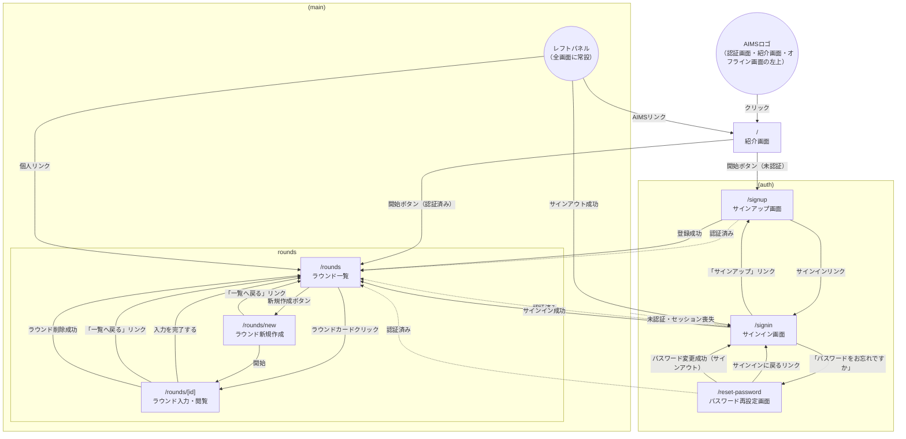

# Features

機能ごとの要件と設計を `<対象>/<機能>/` に置く。

- `requirements.md`: ユーザーから見た要求。何を満たすか。
- `design.md`: 現在の実現方法と、守るべき判断の理由・見直す条件。経緯（過去の判断、却下案、出典）は書かず、Issue / PR / git履歴を参照する。

## requirements.md の書式

要求は親と子の2段で書く。
親はユーザーができること・得られる機能で、E2Eテストが1行1件で対応する。
子は親が成立するための具体的な条件（表示・操作、計算・順序の規則、保持・同期の方式、入力の制約など）で、単体テストやpgTAPなど、E2E以外の手段で確かめる。
子は1つの親に属し、子の下に子を置かない。
親の行はすべてE2Eテストを持ち、子はすべて確かめる手段を持つ。どちらかが欠けたものは、それを足すPRで、E2Eか確かめる手段を足すか、分類を見直す。
目的、対象画面のパス、範囲は`design.md`の概要に書く。

### 親と子の見分け

- 利用者がそれ自体を結果として得る・求めるなら親、親を成立させる条件で、それ単独では利用者の目的にならないなら子とする。
- 検証の手段では決めない。単体テストで確かめられるロジックがあることだけを理由に、親を子にしない。子がE2Eでしか確かめられないように見えるときは、分類を見直す（親か、別の手段で確かめられる子か）。
- 目的を達成する手段の動作（詳細、ダイアログ、メニュー、テンキーを開く・格納する）は親にしない。必要なら、その手段を使う親の子に置く。親のE2Eは、目的を達成する途中で手段を使ってよい。
- 目的と手段の操作が重なる場合は、操作を`When`に、目的の達成を`Then`に書く。例: テンキーで点数を記録するとき、目的は点数の記録で、テンキーの展開は手段である。「点数ボタンをクリックすると、その点数の矢が記録される」を親にし、「テンキーが展開される」を`Then`とする親は置かない。
- 親の例: 点数を記録できる、再読み込みしても点数が残る、距離の的を変更できる、一覧へ戻れる。
- 子の例: キーの色は的の色に揃える（親: 点数を記録できる）、合計はエンドの小計の和になる、再送の間隔は段階的に伸びる、入力は1〜50の範囲に限る。
- 親にしない例（手段の動作）: テンキーを展開する、距離概要をクリックして距離編集ダイアログ（距離の詳細）を開く、メニューを展開する。

### 書き方

子のない機能は、親を1つの表に並べる。
子を1件でも置く機能は、親ごとに見出し`## <親ID>`を立て、その下に親の1行の表と、子の箇条書きを置く。子のない親にも見出しを立てる。

例（子を置く機能）:

```
## score-03

| ID | Given | When | Then |
| :--- | :--- | :--- | :--- |
| score-03 | ラウンド詳細画面で矢数に達していないエンドがある | 点数ボタンをクリックする | その点数の矢が記録される |

- score-03-1: キーの色は的の色に揃える（単体）
```

### 親の行

| ID | Given | When | Then |
| :--- | :--- | :--- | :--- |

- `ID`: `<機能>-NN`。変更しない。削除した行のIDは欠番にする。追加した行は、並び順の規則に従う位置に置き、IDは連番でなくてよい。見出しを立てる機能では、見出しを親のIDと同じにする。
- `Given`: 前提。画面や対象の状態と、利用者やデータの付帯条件（例: ラウンド詳細画面で距離がない）。
- `When`: ユーザーの操作、またはオンライン復帰・オフライン化・時間経過などの外部イベント。1行につき1つ。画面を開く行は「<パス>を開く」と書く。
- `Then`: ユーザーができること、得られる結果が実現されているか。画面で観測できる形に限らず、システムの内部動作でなく、ユーザーから見た結果や、ユーザーにできることとして書く。手段の動作とその状態は書かない。主語に応じて能動態と受動態を使い分ける（例: 「ラウンドが削除されない」「再度サインインできる」）。結果が複数あるときは`<br>`で区切り、テスト名では「、」でつなぐ。
- 親の行は正常系、境界、異常系の順に並べ（見出しを立てる機能では見出しの順）、E2Eテストの順序と一致させる。
- 確かめる手段: 親の行は、名前が `<ID>:` で始まるE2Eテストで確かめる。表に列を足さず、この規則で全ての親の行の確かめる手段とする。そのテストがない親の行は、確かめる手段が欠けている。
- E2Eテストは親の1行につき1件とし、テスト名を `<ID>: <Given>のとき、<When>すると、<Then>` の形にし、要求の文を読みやすくつないで書く。「Given」「When」「Then」の語は書かない。結果に「〜すると」などの行動や条件を混ぜない。Givenが行動から自明なときは省いてよい（例: 「ラウンド削除確認ダイアログの背景をクリックすると、ラウンドが削除されない」）。Whenに時間を進める操作を含めてよい。
- 入力検証と送信失敗のエラー表示は、機能ごとに代表1件を親に置く。代表であることが分かるよう「エラーメッセージが表示される」をThenとし、E2Eの本文に代表例であるコメントを置く。個別の検証規則は子に置き、単体テストで網羅する。
- 共通部品（確認ダイアログ、メニューなど）は、各機能の画面が正しく使っていることを、その機能でできること（例: ラウンドを削除する、削除をやめる）として親で確かめる。共通部品であることを理由に省かない。開閉そのものは親の`Then`にしない。
- 同じ分岐を検出する重複する親の行は、代表1行にまとめる。
- 親から外す行（削除する、子へ移す）は、外す理由と、代表の行ID・確かめる手段を、同じPRの説明に記録する。
- 実装済みで要求にない振る舞いのうち、ユーザーから観測できるものは、確認のうえ親か子として追加する。

### 子

- 文は `<親ID>-<枝番>: <条件>（<種類>）` とし、その親の見出しの下、親の表の後に箇条書きで置く。子の下に子を置かない。
- `ID`: 枝番は親ごとに1からの連番で、変更しない。削除した子の枝番は欠番にする。
- 条件: 親が成立する条件を1項目に1つ、現在形で書く。独自の前提があれば文に含める。
- 確かめる手段: 文末の全角括弧に、テストの種類を`（単体）`（Vitest）か`（pgTAP）`で書く。両方で確かめるときは`（単体、pgTAP）`とする。E2Eは書かない。テストのファイルのパスは書かない。
- 子とテストの対応は、テストの側に子のIDを書いて取る。子を確かめるテストは、名前か説明に `<子ID>:` を含める（`agents/testing.md`）。
- 括弧がない子と、`<子ID>:` を含むテストがない子は、確かめる手段が欠けている（例: `grep -rn "score-03-1:" apps/web/src supabase/tests`）。
- 同じ親の子は枝番の順に並べる。確かめる手段のない子は置かない。

## design.md の書式

見出しは次の順で、該当しない節は省く。

1. `概要`: 方式の要点と最重要の判断。
2. `画面と状態`: 状態遷移表。「要求」列にrequirementsのIDを書いて対応づける。
3. `構成とデータの流れ`: 責務単位のファイル一覧（1ファイル1行）と流れ。DB・RPCの契約（認可、冪等性、副作用）を現在形で書く。コードを読めば分かる詳細と行番号は書かない。
4. `設計判断`: 表 `判断 | 理由 | 見直す条件`。変更費用が高い、または一見不合理で直したくなる判断だけを載せる。再提案されやすい却下案は、理由欄に「〜は〜のため採らない」と1文で書く。
5. `制約と未対応`: 現在の既知の制約と、扱っていない範囲。

- 現在の設計だけを書く。後で覆された判断、「不明な点」、記録がない却下案は書かない。ただし、戻すと同じ問題が再発する判断は、理由欄に「〜のため〜をやめた」と1文で残す。
- 出典 `#N` は、「制約と未対応」の未解決Issueと、変更前に読むべき根拠がある場合（`詳細: #N`）に限り、1文書0〜3件とする。
- 設計が変わったら、同じPRで該当節を更新し、古い記述を残さない。

## 新機能か既存機能の修正か

判断基準は、ユーザーの目的が新しいかどうかである。

- 修正: 既存の目的を達成する手段、表示、挙動が増える・変わる場合。既存の`requirements.md`の親か子を追加・変更・削除し、`design.md`の該当節を更新する。手段だけが変わる場合は、その手段を通る親の`Given`と`When`と、手段の条件を書いた子を直し、手段の動作を親として足さない。
- 新機能: 独立した目的で、固有の要求の集合や画面を持つ場合。機能ディレクトリを新設する。
- 迷う場合は、既存の行を変えずに足せるなら修正、足せないなら新機能とする。

## 機能一覧

| 対象 | 機能 | ユーザーの目的 | roadmap.mdの機能 |
| :--- | :--- | :--- | :--- |
| auth | signup | アカウントを作る | Email/PW認証 |
| auth | signin | サインインする | Email/PW認証 |
| auth | password-reset | パスワードを再設定する | PW再設定 |
| auth | signout | サインアウトする | Email/PW認証 |
| rounds | start | ラウンドを始める | ラウンド・種目管理 |
| rounds | score-entry | 矢の点数を記録・修正する | 素点テンキー入力、誤入力修正・差し替え |
| rounds | setup | ラウンドの設定を変える | 基本属性入力、的（ターゲット）管理、ラウンド・種目管理 |
| rounds | preset | 構成をプリセットにして管理する | ラウンド・種目管理 |
| rounds | history | 過去のラウンドを探す | 履歴一覧・スコア詳細 |
| rounds | detail | ラウンドの成績を見る | 履歴一覧・スコア詳細 |
| rounds | completion | ラウンドの入力を完了にする | 履歴一覧・スコア詳細 |
| rounds | delete | ラウンドを削除する | 履歴一覧・スコア詳細 |
| rounds | sync | 記録を失わず同期する | RDBMS・データ基盤 |
| app | navigation | 迷わず移動する | 最小限の紹介画面、基本テーマ |
| app | offline-pwa | アプリとして入れて、オフラインでも使う | PWA・オフライン点数記録 |

## 画面遷移図

実線：ユーザー操作による遷移
破線：認証状態による自動リダイレクト（入口のガードと、表示中のセッション喪失の検知）



