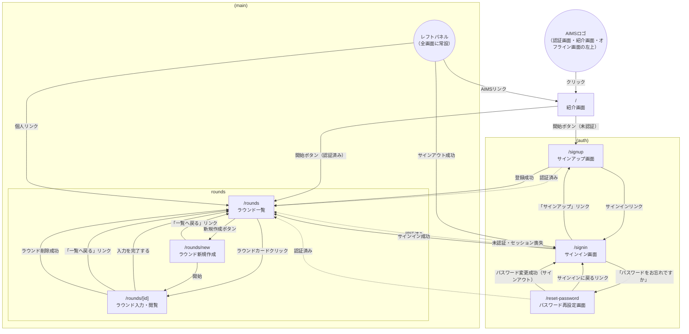

# Features

機能ごとの要件と設計を `<対象>/<機能>/` に置く。

- `requirements.md`: 利用者に保証する要求の正本。目的、要求、対象外を書く。
- `design.md`: 現在の実現方法と、守るべき判断の理由・見直す条件。経緯（過去の判断、却下案、出典）は書かず、Issue / PR / git履歴を参照する。

## requirements.md の書式

見出しは「目的」「要求」「対象外」の順にする。
目的には利用者が達成したいこと、対象外には保証しない範囲を書く。
要求には、利用者から見た結果やできることを、条件と保証内容が1行だけで分かる文で書く。
独立して検証できる規則は行を分ける。
実現方法と内部処理は`design.md`に書き、入力値や表示の詳細な組合せはテストで扱う。
画面の配置とデザイン(寸法、余白、折り返し、列数、並ぶ向き、中央寄せ、横にあふれないこと、配色、文字の収まり、パネルの位置、動きの見た目(アニメーションの見え方))は要求に書かず、操作や状態で変わる表示の内容と有無、有効と無効、開閉、選択、記録、データの並び順、遷移、文言を書く。
見た目を変えても利用者の目的を達成できるなら配置・デザインとする。
ただし、操作や状態の変化の結果として対象が隠れるか見えるかが変わること(動作が伴う見た目。例: スクロールしても合計が隠れずに見えること、矢を指した後、点数を入力した後に、指す矢が隠れずに見えること)は、見える結果で要求に書き、位置、固定の方式、クラスを書かない。
代表例と補足の常設欄は設けない。
要求は、場面ごとの見出し(`###`)で区切り、見出しの外に要求を置かない。
場面は、利用者がその機能の中で置かれる状況または段階である(例: 主な目的を達成する、認証コードの入力中、ほかの画面へ進む、認証済みで開く、不備や失敗があるとき)。
各要求はちょうど1つの場面に置き、複数の場面に関わる保証は最も関わる場面に置く。各場面は1行以上の要求を持つ。
場面は、主な目的を達成する場面を先頭にし、補助の導線、例外や失敗の場面を後に置く。見出し名は利用者の場面を表す名詞句または状況の説明とし、実現方法や内部の名前を含めない。

- 要求は箇条書きにし、識別子を付けない。
- 要求とテストの対応表は作らない。
- 要求とテストは1対1にせず、各テスト層の責任は[`agents/testing.md`](../../agents/testing.md)に従う。
- 実装済みで要求にない振る舞いのうち、利用者から観測できるものは、確認のうえ要求に追加する。

既存featureは一括変換せず、変更するfeatureから`requirements.md`全体を新書式へ移行する。
移行時は既存の保証内容を引き継ぎ、テストケースの詳細を要求から整理する。
移行時は、その機能のテストファイルを[`agents/testing.md`](../../agents/testing.md)のフェーズ(Given・When・Thenの区分を含む)、1テスト1つの振る舞い、リンク、段階コメントの規則に適合させ、`requirements.md`の移行と同じ変更で行う。
対象は、`design.md`の「構成とデータの流れ」に挙がるファイルのテストのうち、その行が挙げる責務を検証するテストとする。同じファイルにある他の機能の責務のテストは変えず、その機能の移行時に適合させる。

## design.md の書式

見出しは次の順で、該当しない節は省く。分量の目安は50〜80行。

1. `概要`: 対象画面のパス、方式の要点と最重要の判断（3〜5行）。
2. `画面と状態`: 状態遷移表。
3. `構成とデータの流れ`: 責務単位のファイル一覧（1ファイル1行）と流れ。DB・RPCの契約（認可、冪等性、副作用）を現在形で書く。コードを読めば分かる詳細と行番号は書かない。
4. `設計判断`: 表 `判断 | 理由 | 見直す条件`。変更費用が高い、または一見不合理で直したくなる判断だけを載せる（目安は6〜8行）。再提案されやすい却下案は、理由欄に「〜は〜のため採らない」と1文で書く。
5. `制約と未対応`: 現在の既知の制約と、扱っていない範囲。

- 現在の設計だけを書く。後で覆された判断、「不明な点」、記録がない却下案は書かない。ただし、戻すと同じ問題が再発する判断は、理由欄に「〜のため〜をやめた」と1文で残す。
- 出典 `#N` は、「制約と未対応」の未解決Issueと、変更前に読むべき根拠がある場合（`詳細: #N`）に限り、1文書0〜3件とする。
- 設計が変わったら、同じPRで該当節を更新し、古い記述を残さない。

## 新機能か既存機能の修正か

判断基準は、ユーザーの目的が新しいかどうかである。

- 修正: 既存の目的を達成する手段、表示、挙動が増える・変わる場合。既存の`requirements.md`の行を追加・変更・削除し、`design.md`の該当節を更新する。
- 新機能: 独立した目的で、固有の要求の集合や画面を持つ場合。機能ディレクトリを新設する。
- 迷う場合は、既存の行を変えずに足せるなら修正、足せないなら新機能とする。

## 機能一覧

| 対象 | 機能 | ユーザーの目的 | roadmap.mdの機能 |
| :--- | :--- | :--- | :--- |
| auth | signup | アカウントを作る | Email/PW認証 |
| auth | signin | サインインする | Email/PW認証 |
| auth | password-reset | パスワードを再設定する | PW再設定 |
| auth | signout | サインアウトする | Email/PW認証 |
| rounds | start | ラウンドを始める | ラウンド・種目管理 |
| rounds | score-entry | 矢の点数を記録・修正する | 素点テンキー入力、誤入力修正・差し替え |
| rounds | setup | ラウンドの設定を変える | 基本属性入力、的（ターゲット）管理、ラウンド・種目管理 |
| rounds | preset | 構成をプリセットにして管理する | ラウンド・種目管理 |
| rounds | history | 過去のラウンドを探す | 履歴一覧・スコア詳細 |
| rounds | detail | ラウンドの成績を見る | 履歴一覧・スコア詳細 |
| rounds | completion | ラウンドの入力を完了にする | 履歴一覧・スコア詳細 |
| rounds | delete | ラウンドを削除する | 履歴一覧・スコア詳細 |
| rounds | sync | 記録を失わず同期する | RDBMS・データ基盤 |
| app | navigation | 迷わず移動する | 最小限の紹介画面、基本テーマ |
| app | offline-pwa | アプリとして入れて、オフラインでも使う | PWA・オフライン点数記録 |

## 画面遷移図

実線：ユーザー操作による遷移
破線：認証状態による自動リダイレクト（入口のガードと、表示中のセッション喪失の検知）

