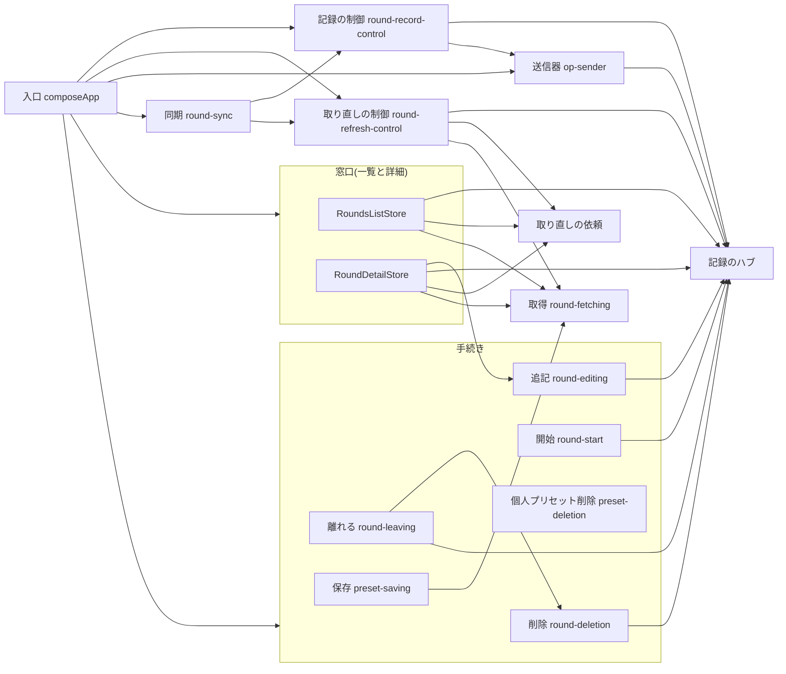

# rounds 共通設計

## 概要

一覧・作成・詳細・同期が共有する構造と、機能ごとに別の言い方にしない判断を書く。
機能ごとの画面と流れは、各機能の`design.md`に従う。構造の方針は`docs/architecture.md`に従う。
画面へ状態と変更の方法を渡す窓口は一覧と詳細の2つ(`RoundsListStore`、`RoundDetailStore`)で、作成の画面は窓口を持たず、手続きは画面に属し、記録のハブは1つで、同期は同期からラウンドへの一方向である。
一覧・作成・詳細の画面は、離れる・ラウンドの削除(一覧)・開始・プリセットの保存と削除と取得・IDの払い出し・オンライン復帰の通知(`whenOnline`)を、手続きの入れ物(`RoundProcedures`)から直接受ける。作成の画面は窓口を持たず、一覧と詳細は窓口も受ける。
複数の画面で使う`whenOnline`は、一覧と作成が手続きの入れ物から、詳細が窓口から受け、共有フック`useFetchResult`は受け元を知らずに引数で受ける。
入口は層までのパスで各層の生成関数を取り込む(`docs/architecture.md`の「2. 規則」の参照の書き方。入口から機能の中へは層までのパス)。

## 構造図

認証、接続、時計、データベースは図の外の入力である。

## 構成

### 窓口のメンバー

一覧の窓口`RoundsListStore`(`features/rounds/application/rounds-list-store.ts`)

| メンバー | 内容 | 委譲先・実装 |
| --- | --- | --- |
| `loadList()` | 一覧の取得を行い、端末の列で削除済みのラウンドのIDを添えて一覧の材料を返す。`FETCH_TIMEOUT_MS`で打ち切る。拒否することがある | 窓口内、`fetching.fetchRoundsList`、`hub` |
| `loadLocalList()` | 端末の入力中のラウンドの一覧(保存済みの的は読まない) | 窓口内 |
| `subscribe(listener)` | 端末の記録が変わるたびに呼ぶ。返す関数で解除する | `hub.subscribe` |

詳細の窓口`RoundDetailStore`(`round-detail-store.ts`)

| メンバー | 内容 | 委譲先・実装 |
| --- | --- | --- |
| `load(roundId)` | 開く材料。`FETCH_TIMEOUT_MS`で打ち切る | 窓口内、`requests.open` |
| `round(roundId)` | 購読と操作の追記を持つ`RoundHandle`(ラウンドごとに1つ) | `round-handle.ts` |
| `newShotId(endShotIds)` | そのエンドの既存の矢より後ろに並ぶ時刻順の矢のID | `shotIdAfter` |
| `whenOnline(listener)` | 共有表のとおり | `when-online.ts` |

複数の画面で使うメンバー

| メンバー | 使い手の画面 | 置き場 | 理由 |
| --- | --- | --- | --- |
| `whenOnline` | 一覧、作成、詳細(`use-fetch-result.ts`が各画面の受け元の関数を引数で受ける) | 一覧と作成は手続きの入れ物が、詳細は詳細の窓口が持つ。実装は`application/when-online.ts`の1つ | 窓口は判断か写しを持つメンバーだけにし、共有フックが窓口に依存しない。契約と挙動は1か所 |
| 窓口の文脈(`ui/rounds-context.tsx`) | 一覧、詳細 | 窓口ごとに別の文脈(Providerとhookを各窓口に1つずつ) | 画面は自分の窓口だけを取り出せる。テストは使う窓口だけを渡す |
| 手続きの入れ物`RoundProcedures`(`ui/rounds-context.tsx`) | 詳細(完了`use-scorecard.ts`、削除`round-menu.tsx`、プリセットの保存`save-preset-dialog.tsx`、IDの払い出し`round-config-panel.tsx`・`use-distance-draft.ts`・`use-distance-editing.ts`・`use-shot-input.ts`)、一覧(削除`rounds-list.tsx`の`deletion.deleteRound`、`whenOnline`)、作成(開始`use-start-round.ts`の`roundStart.startRound(preset, isCurrent)`、個人プリセットの削除`use-preset-delete.ts`の`presetDeletion.deletePreset(presetId, isCurrent)`、取得`round-preset-select.tsx`の`fetching.fetchPresets`、`whenOnline`) | 離れる手続き`leaving`(`completeRound`、`deleteRoundAndLeave`)、離れない削除の手続き`deletion`(`deleteRound`。一覧が使う)、開始の手続き`roundStart`、保存の手続き`presetSaving`(`savePreset`)、個人プリセットの削除の手続き`presetDeletion`、取得`fetching`(`fetchPresets`だけ)、`ids`(`next`)、`whenOnline`を1つの文脈(Providerとhookを1つ)にまとめる | 窓口を通さずに手続きを直接受ける。素通しの窓口(作成)を持たず、別の文脈にすると入口の入れ子が増える |

使い手のないメンバー`append`(窓口の直接の追記)は持たない。追記は`round(roundId).append`が手続き`round-editing.ts`を通して行う。
窓口の生成は、状態を持たない部分をモジュール関数に出し、deps(受け取る手続きと部品)を引数で受ける。状態を閉じ込める`createRoundHandle`(`round-handle.ts`)だけが関数の長さの例外を持つ。

### UI層のファイルと画面の対応

| 画面 | ファイル | 窓口(hook) |
| --- | --- | --- |
| 一覧 | `rounds-list.tsx`、`use-local-rounds-list.ts` | `useRoundsListStore`(`loadList`、`loadLocalList`、`subscribe`)、`useRoundProcedures`(`deletion`、`whenOnline`) |
| 作成 | `round-preset-select.tsx`、`preset-list.tsx`、`use-start-round.ts`、`use-preset-delete.ts` | 窓口なし。`useRoundProcedures`(`roundStart`、`presetDeletion`、`fetching`、`whenOnline`) |
| 詳細 | `round-detail-client.tsx`、`use-creation-gone.ts`、`use-round-op-stack.ts`、`use-scorecard.ts`、`use-shot-input.ts`、`use-distance-editing.ts`、`distance-edit-fields.tsx`、`distance-fields.tsx`、`use-distance-draft.ts`、`round-config-panel.tsx`、`round-menu.tsx`、`save-preset-dialog.tsx` | `useRoundDetailStore`(`load`、`round`、`newShotId`、`whenOnline`)、`useRoundProcedures`(`leaving`、`presetSaving`、`ids`。`round-detail-client.tsx`は使わない) |
| 詳細(窓口を使わない) | 上以外の`ui/`のファイル(`scorecard-client.tsx`、`round-summary-bar.tsx`、`end-row.tsx`、`keypad-panel.tsx`ほか) | なし(propsで値と関数を受ける) |
| 複数画面 | `use-fetch-result.ts`、`fetch-state.tsx` | なし(`use-fetch-result.ts`は`whenOnline`を引数で受ける) |
| 複数画面 | `preset-info.tsx`、`target-face-info.tsx` | なし(表示だけ。作成と詳細が使う) |
| 複数画面 | `rounds-context.tsx` | 一覧と詳細の窓口の文脈と、手続きの入れ物の文脈を定義 |

`round-config-panel.tsx`は詳細(スコアカードの設定の節)、`save-preset-dialog.tsx`は詳細(スコアカードのヘッダー)に属する。

### 入口の組み立て

入口(`app/root-client-entry.tsx`)は、責務ごとの5つの関数を呼んで結ぶ。入力(認証、識別情報の保存、接続、時計、データベース、遷移)、記録と取得(ハブ、依頼の記録、取得、送信器、記録の制御、取り直しの制御)、窓口(手続きと、一覧と詳細の窓口)、同期(同期と契機)、オフライン(更新の切り替えの手続き。`features/offline-pwa`)。

| 部品 | 受ける部品(引数で渡す) |
| --- | --- |
| 削除の手続き`RoundDeletion` | ハブ、ID |
| 離れる手続き`RoundLeaving` | ハブ、ID、遷移、削除の手続き |
| 追記の手続き`RoundEditing` | ハブ、ID |
| 開始の手続き`RoundStart` | ハブ、サインインの読み手、ID、時計、遷移 |
| 個人プリセット削除の手続き | サインインの読み手、命令、保存済み |
| 保存の手続き | サインインの読み手、命令、取得 |
| 一覧の窓口 | ハブ、取得、時計、接続 |
| 詳細の窓口 | ハブ、依頼の記録、取得、時計、接続、ID、追記の手続き |
| 手続きの入れ物 | 離れる手続き、削除の手続き、開始の手続き、保存の手続き、個人プリセット削除の手続き、取得、ID、接続(`whenOnline`) |

詳細の窓口と取り直しの制御は同じ依頼の記録を受ける(`app/round-sync-integration.test.ts`が検証する)。
一覧と詳細の窓口の文脈と手続きの入れ物の文脈は入れ子にして`children`を包む。同期と契機、オフラインの組み立ては窓口と無関係である。

### 窓口に関わるファイル

- `features/rounds/application/`: `rounds-list-store.ts`、`round-detail-store.ts`(窓口)、`round-handle.ts`(開いた詳細の購読と追記)、`when-online.ts`(通信の復帰の合図)、`round-deletion.ts`(画面に残る削除)、`round-leaving.ts`(完了、削除して離れる)、`time-limit.ts`(`withinFetchTimeout`を持つ)、`content-fetcher.ts`(認証つきの取得と、auth-rejectedでのセッション更新・1回の取り直し。`QueryOutcome`から`FetchResult`への変換は`fetchResultOf`を呼ぶ)。
- `features/rounds/domain/`: `fetch-status.ts`(取得の結果`FetchResult`(失敗は種類`reason`で持つ)、サインインの確認の失敗の種類`signInFailure`、`QueryOutcome`から結果への`fetchResultOf`)、`fetch-wait.ts`(時間制限の値と代わりを返す`withFallback`)、`query-outcome.ts`(問い合わせの結果の種類`QueryOutcome`、型だけ)。
- `features/rounds/infrastructure/`: `db-response-outcome.ts`(データベースの応答を`QueryOutcome`の種類へ写し、複数の応答を畳む優先順を持つ`failureOfResponses`)。
- `features/rounds/ui/`: `rounds-context.tsx`(窓口の2つの文脈と手続きの入れ物の文脈)、`use-fetch-result.ts`(`whenOnline`を引数で受ける)。

## 命名の規則

構造の部品の命名(型だけ・定数だけのファイルの`-types`、`-constants`、約束のファイル名を含む)は、`agents/implementation.md`の「構造の部品の命名」に従う。

該当ファイルの検査: `features/rounds`と`features/round-sync`の全層から`*types*`、`*constants*`、`*-type.ts`を探すと、`domain/scorecard-types.ts`、`domain/round-constants.ts`、`infrastructure/reference-query-constants.ts`が該当し、いずれも型だけ、定数だけで適合する。型と関数を持つ`domain/target-face.ts`は、概念の名前で呼ぶ。アプリケーション層、UI層、`round-sync`に該当する名前のファイルは無い。

## テスト補助の置き場の規則

規則と共有の偽物の表は`agents/testing.md`の「テスト補助の置き場」に持つ。ラウンドで共有の偽物を使わない箇所は、次の2つである。

| 置き換えない箇所 | 理由 |
| --- | --- |
| `content-fetcher.test.ts`の`Connectivity` | 取得の途中で購読者へ知らせずに切断の状態だけを替える検証(HTTP応答のあるエラーはerrorのまま、時間切れはofflineを返す、など)があり、`createFakeConnectivity`は状態を替えると必ず購読者へ知らせるため、同じ検証にならない |
| `sync-triggers.test.ts`の`Connectivity` | `onOnline`を購読した依頼の回数と、解除後の購読数を別々に検証する。`createFakeConnectivity`は有効な購読数だけを持ち、依頼した回数は持たない |

`ui/scorecard-client.test.tsx`のルーターの差し替えは`next/navigation`の差し替えで、`PageNavigation`を満たす値ではないため対象外である。

## 設計判断

| 判断 | 理由 | 見直す条件 |
| --- | --- | --- |
| 窓口は判断か写しを持つ一覧と詳細だけにし、作成は手続きの入れ物から直接受ける。`whenOnline`は一覧と作成が手続きの入れ物から、詳細が窓口から受ける | 手続きへの委譲だけの窓口は、テストの差し替えのための層になるため置かない。共有フックは受け元に依存しない | 作成の画面が判断を持つとき |
| 操作のIDは詳細の画面が手続きの入れ物の`ids`から受ける(矢のIDは窓口の`newShotId`) | 操作を組み立てるのは詳細の画面だけで、一覧の削除と作成の開始は手続きが払い出すため。操作の組み立てを手続きへ移す案は、同じ操作を表す型が2つになり、指す矢と履歴の持ち主が画面と手続きに分かれるため採らない | 操作の組み立てを全て手続きへ移すとき |
| 削除は一覧が手続きの入れ物の`deletion.deleteRound`(画面に残る)、詳細が`leaving.deleteRoundAndLeave`(離れる)を直接受けて呼び、手続きも`round-deletion.ts`と`round-leaving.ts`に分ける | 各窓口に削除が1つになり、他画面の削除を指す注記が要らなくなるため。手続きを分けない案は、一覧が「離れる手続き」の削除を引き、手続きの責務の説明が画面と合わないため採らない | 一覧と詳細の削除の手続きが同じ変更を受け続けるとき |
| 取得結果の型・失敗の種類・分類・時間制限を`rounds`の内側に置く(層ごとに分ける。文言はUI層の一覧が持つ) | `FetchResult`の失敗の種類と分類は業務の言葉を持ち、`rounds`以外の機能が使っていないため。共有へ上げる条件は、`rounds`以外の機能が使う、または`docs/architecture.md`の「1. 構造」の共有の技術(業務の言葉を持たない)を満たす見込みのとき。上げられるのは`FETCH_TIMEOUT_MS`・`FALLBACK_WAIT_MS`・`waitLimitMs`だけで、`FetchResult`の種類、`withFallback`は共有に置けない(「1. 構造」の共有の技術) | 他の機能が取得結果の型や時間制限を使うとき |
| 入口は層までのパスで各層の生成関数を取り込む | `docs/architecture.md`の「2. 規則」の参照の書き方(入口から機能の中へは層までのパス)に従うため | 規則が変わったとき |
| テスト補助は使う層のうち最も内側の層に置く | 参照の向きを依存の向きに合わせ、補助が使い手より外側の層に置かれて層が不明になることを避けるため | テストの置き場の方針が変わったとき |
