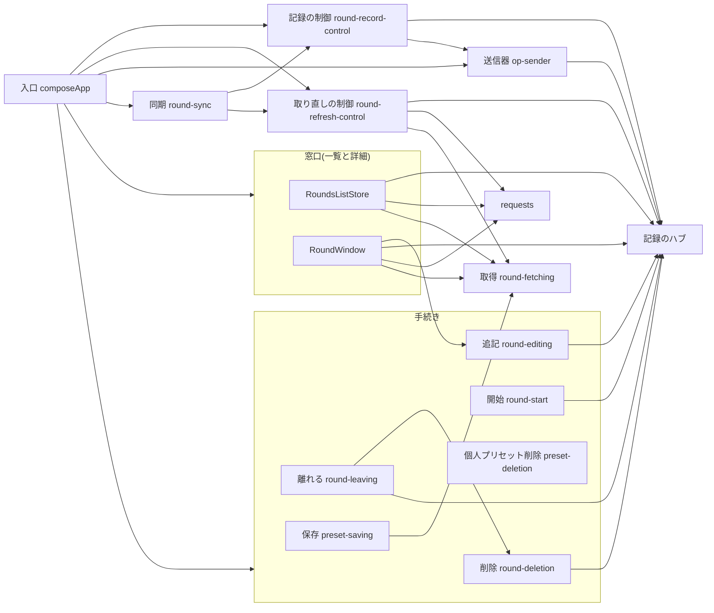

# rounds 共通設計

## 概要

ホーム・点数一覧・ラウンドの開始画面・詳細・同期が共有する構造と、機能ごとに別の言い方にしない判断を書く。
機能ごとの画面と流れは、各機能の`design.md`に従う。構造の方針は`docs/architecture.md`に従う。
画面へ状態と変更の方法を渡す窓口は履歴の取得(`RoundsListStore`。ホームは使わない)と、端末内の取得と同期の窓口(`RoundWindow`。詳細の購読と端末内の入力中一覧)の2つで、ラウンドの開始画面は窓口を持たず、手続きは画面に属し、記録のハブは1つで、同期は同期からラウンドへの一方向である。
ホーム・点数一覧・ラウンドの開始画面・詳細の画面は、離れる・ラウンドの削除(ホームと点数一覧)・開始・プリセットの保存と削除と取得・IDの払い出し・オンライン復帰の通知(`whenOnline`)を、手続きの入れ物(`RoundProcedures`)から直接受ける。ラウンドの開始画面は窓口を持たず、ホーム(`RoundWindow`だけ)、点数一覧(両方)、詳細は窓口も受ける。
複数の画面で使う`whenOnline`は、手続きの入れ物から受け、共有フック`useFetchResult`と点数一覧の`use-history-pages.ts`は受け元を知らずに引数で受ける(詳細の窓口は、offlineの間の自動の再取得を窓口の内側で行う)。
入口は層までのパスで各層の生成関数を取り込む(`docs/architecture.md`の「2. 規則」の参照の書き方。入口から機能の中へは層までのパス)。

### 構造図

認証、接続、時計、データベースは図の外の入力である。

## 構成とデータの流れ

### 窓口のメンバー

履歴の窓口`RoundsListStore`(`features/rounds/application/rounds-list-store.ts`)

| メンバー | 内容 | 委譲先・実装 |
| --- | --- | --- |
| `readDeleted()` | 端末の列で削除済みのラウンドのIDを、取得せずに返す(戻ったときの表示に使う) | `hub` |
| `loadList(condition, after, size)` | 条件と続きの起点と件数で、履歴の1ページ(サーバーで完了と記録されたラウンド)の取得を行い、端末の列で削除済みのラウンドのIDを添えて履歴の材料を返す。`FETCH_TIMEOUT_MS`で打ち切る。拒否することがある | 窓口内、`fetching.fetchRoundsList`、`hub` |

窓口`RoundWindow`(`features/rounds/application/round-window.ts`。エントリは`round-window-entry.ts`)

| メンバー | 内容 | 委譲先・実装 |
| --- | --- | --- |
| `watch(roundId, listener)` | 詳細のIDを購読する。購読者が0→1でエントリを作り、1→0で捨てる。同じIDの購読者は1つのエントリを共有する | `hub`、`fetching`、`refresh.refreshRound`、`requests.watch`/`setOverlay`(3b で`readyRounds`に替わる) |
| `view(roundId)` | `FetchView<RoundScreen>`(読み込み中・準備完了・存在しない・オフライン・エラー)。購読が無い、または記録の読み込み前は読み込み中。参照は内容が変わるまで同じ | エントリ |
| `retry(roundId)` | offline/errorのとき取得をやり直す | エントリ |
| `append(roundId, operation)` | 準備完了の間だけ、追記の直後の画面の状態を返す。それ以外は例外 | `round-editing.ts` |
| `watchLocalList(listener)` | 端末内の入力中一覧の変化を購読する。返す関数で解除する。購読者が0→1で記録の購読を始め、1→0で値を捨てる | `hub.subscribe` |
| `localList()` | 端末内の入力中一覧。購読が無い、または読み込み前は`null` | 窓口内 |

複数の画面で使うメンバー

| メンバー | 使い手の画面 | 置き場 | 理由 |
| --- | --- | --- | --- |
| `whenOnline` | 点数一覧(`use-history-pages.ts`。先頭のページのオフラインの間だけ)、ラウンドの開始画面、詳細の不正なID(`use-fetch-result.ts`)。どちらも受け元の関数を引数で受ける | 手続きの入れ物が持つ。実装は`application/when-online.ts`の1つ | 窓口は判断か写しを持つメンバーだけにし、共有フックが窓口に依存しない。契約と挙動は1か所 |
| 窓口の文脈(`ui/rounds-context.tsx`) | ホーム(`RoundWindow`)、点数一覧、詳細 | 窓口ごとに別の文脈(`RoundsListStore`と`RoundWindow`。Providerとhookを各窓口に1つずつ) | 画面は自分の窓口だけを取り出せる。テストは使う窓口だけを渡す |
| 手続きの入れ物`RoundProcedures`(`ui/rounds-context.tsx`) | 詳細(完了`use-scorecard.ts`の`leaving.completeRound(roundId, isCurrent)`、削除`round-menu.tsx`の`leaving.deleteRoundAndLeave(roundId, origin, isCurrent)`、プリセットの保存`save-preset-dialog.tsx`、IDの払い出し`round-config-panel.tsx`・`use-distance-draft.ts`・`use-distance-editing.ts`・`use-shot-input.ts`)、ホームと点数一覧(削除`round-delete.tsx`の`deletion.deleteRound`、点数一覧の`whenOnline`、履歴の条件の記憶`use-history-view.ts`の`historyViewMemory`、戻ったときの表示の記憶`use-history-pages.ts`の`historyPagesMemory`)、ラウンドの開始画面(開始`use-start-round.ts`の`roundStart.startRound(preset, isCurrent)`(結果は`created`か`failed`(`unauthenticated`、`left`)。離れた後の追記と遷移を手続きの待ちの後に止めるため`isCurrent`を残す。完了・削除も同じ形で保存の完了の後に`isCurrent`を問う)、個人プリセットの削除`use-preset-delete.ts`の`presetDeletion.deletePreset(presetId)`、取得`round-preset-select.tsx`の`fetching.fetchPresets`、`whenOnline`) | 離れる手続き`leaving`(`completeRound`、`deleteRoundAndLeave`)、離れない削除の手続き`deletion`(`deleteRound`。ホームと点数一覧が使う)、開始の手続き`roundStart`、保存の手続き`presetSaving`(`savePreset`)、個人プリセットの削除の手続き`presetDeletion`、取得`fetching`(`fetchPresets`だけ)、`ids`(`next`)、`whenOnline`、履歴の条件の記憶`historyViewMemory`(`read`、`write`)、戻ったときの表示の記憶`historyPagesMemory`(`save`、`read`、`clear`)を1つの文脈(Providerとhookを1つ)にまとめる | 窓口を通さずに手続きを直接受ける。素通しの窓口(ラウンドの開始画面)を持たず、別の文脈にすると入口の入れ子が増える |

追記は窓口の`append`が手続き`round-editing.ts`を通して行う。
窓口の生成は、状態を持たない部分をモジュール関数に出し、deps(受け取る手続きと部品)を引数で受ける。状態を閉じ込める`createRoundEntry`(`round-window-entry.ts`)と`createLocalListWatch`だけが関数の長さの例外を持つ。判断の規則は`features/rounds/domain/round-opening.ts`の純粋関数にある。

### UI層のファイルと画面の対応

| 画面 | ファイル | 窓口(hook) |
| --- | --- | --- |
| ホーム | `rounds-home.tsx`、`use-local-rounds-list.ts` | `useRoundWindow`(`watchLocalList`、`localList`)、`useRoundProcedures`(`deletion`) |
| 点数一覧 | `rounds-history.tsx`、`use-history-pages.ts`、`use-local-rounds-list.ts`、`use-history-view.ts`、`history-controls.tsx` | `useRoundsListStore`(`loadList`、`readDeleted`)、`useRoundWindow`(`watchLocalList`、`localList`)、`useRoundProcedures`(`deletion`、`whenOnline`、`historyViewMemory`、`historyPagesMemory`) |
| ラウンドの開始画面 | `round-preset-select.tsx`、`preset-list.tsx`、`use-start-round.ts`、`use-preset-delete.ts` | 窓口なし。`useRoundProcedures`(`roundStart`、`presetDeletion`、`fetching`、`whenOnline`) |
| 詳細 | `round-detail-client.tsx`、`use-round-screen.ts`、`use-scorecard.ts`、`use-shot-input.ts`、`use-distance-editing.ts`、`distance-edit-fields.tsx`、`distance-fields.tsx`、`use-distance-draft.ts`、`round-config-panel.tsx`、`round-menu.tsx`、`save-preset-dialog.tsx` | `useRoundWindow`(`watch`、`view`、`retry`、`append`)、`useRoundProcedures`(`leaving`、`presetSaving`、`ids`。`round-detail-client.tsx`は不正なIDの部品だけが`whenOnline`を使う) |
| 詳細(窓口を使わない) | 上以外の`ui/`のファイル(`scorecard-client.tsx`、`round-summary-bar.tsx`、`end-row.tsx`、`keypad-panel.tsx`ほか) | なし(propsで値と関数を受ける) |
| 複数画面 | `use-fetch-result.ts`、`fetch-state.tsx` | なし(`use-fetch-result.ts`は`whenOnline`を引数で受ける) |
| 複数画面 | `preset-info.tsx`、`target-face-info.tsx` | なし(表示だけ。ラウンドの開始画面と詳細が使う) |
| 複数画面 | `rounds-context.tsx` | 履歴と詳細の窓口の文脈と、手続きの入れ物の文脈を定義 |

`round-config-panel.tsx`は詳細(スコアカードの設定の節)、`save-preset-dialog.tsx`は詳細(スコアカードのヘッダー)に属する。

### 入口の組み立て

入口(`app/root-client-entry.tsx`)は、責務ごとの5つの関数を呼んで結ぶ。入力(認証、識別情報の保存、接続、時計、データベース、遷移)、記録と取得(ハブ、取得、追記の手続き、取得と反映、窓口、送信器、記録の制御、取り直しの制御)、窓口の文脈に渡す手続きと一覧の取得、同期(同期と契機)、オフライン(更新の切り替えの手続き。`features/offline-pwa`)。

| 部品 | 受ける部品(引数で渡す) |
| --- | --- |
| 削除の手続き`RoundDeletion` | ハブ、ID |
| 離れる手続き`RoundLeaving` | ハブ、ID、遷移、削除の手続き |
| 追記の手続き`RoundEditing` | ハブ、ID |
| 開始の手続き`RoundStart` | ハブ、サインインの読み手、ID、時計、遷移 |
| 個人プリセット削除の手続き | サインインの読み手、命令、保存済み |
| 保存の手続き | サインインの読み手、命令、取得 |
| 履歴の窓口 | ハブ、取得、時計、接続 |
| 窓口`RoundWindow` | ハブ、取得、取得と反映(`refreshRound`)、追記の手続き、時計、接続 |
| 取り直しの制御 | ハブ、窓口(`readyRounds`、`onReadyChange`)、取得と反映 |
| 手続きの入れ物 | 離れる手続き、削除の手続き、開始の手続き、保存の手続き、個人プリセット削除の手続き、取得、ID、接続(`whenOnline`)、履歴の条件の記憶(識別情報の読み手)、戻ったときの表示の記憶 |

取り直しの制御は窓口の準備完了の詳細を読む(`app/round-sync-integration.test.ts`が検証する)。
履歴と詳細の窓口の文脈と手続きの入れ物の文脈は入れ子にして`children`を包む。同期と契機、オフラインの組み立ては窓口と無関係である。

### 窓口に関わるファイル

- `features/rounds/application/`: `rounds-list-store.ts`(履歴の取得)、`round-window.ts`、`round-window-entry.ts`(窓口と詳細のエントリ)、`when-online.ts`(通信の復帰の合図)、`round-deletion.ts`(画面に残る削除)、`round-leaving.ts`(完了、削除して離れる)、`time-limit.ts`(`withinFetchTimeout`を持つ)、`content-fetcher.ts`(認証つきの取得と、auth-rejectedでのセッション更新・1回の取り直し。`QueryOutcome`から`FetchResult`への変換は`fetchResultOf`を呼ぶ)。
- `features/rounds/domain/`: `fetch-status.ts`(取得の結果`FetchResult`(失敗は種類`reason`で持つ)、サインインの確認の失敗の種類`SignInFailure`、`QueryOutcome`から結果への`fetchResultOf`)、`fetch-wait.ts`(時間制限の値)、`query-outcome.ts`(問い合わせの結果の種類`QueryOutcome`、型だけ)。
- `features/rounds/infrastructure/`: `db-response-outcome.ts`(データベースの応答を`QueryOutcome`の種類へ写し、複数の応答を畳む優先順を持つ`failureOfResponses`)。
- `features/rounds/ui/`: `rounds-context.tsx`(窓口の2つの文脈と手続きの入れ物の文脈)、`use-fetch-result.ts`(`whenOnline`を引数で受ける)。

### 的の識別と選択

的の識別は保存した名称を使わず、種別・サイズ・対応弓種・点数帯・配置を使う。
`target_faces.placement`は`single`（単一）、`triangle`（三角三つ目）、`vertical`（縦三つ目）のいずれかで、NOT NULLとCHECKを持ち、既定値は持たない。
配置分類は識別と並べ替えの属性で、描画・採点は既存のスポット座標とリングを使う。
的・スポット・リングのIDと形状、距離とプリセット距離の参照は保持する。
的マスターはmigrationで管理し、認証済みユーザーのSELECTのみを維持する。
配置はmigrationで既存IDへ割り当て、座標との一致とID・形状・参照の保持は既存方式のDBテストで確認する。

| ファイル（`apps/web/src/features/rounds/`からの相対） | 責務 |
| --- | --- |
| `domain/target-face.ts` | 生成型からnameを含まない選択用の型を導き、リングの点数帯・Xの有無・10点半径の要約と、属性による順序を持つ |
| `infrastructure/reference-query-constants.ts` | 的の取得列にplacementを含め、nameを含めない |
| `infrastructure/round-queries.ts` | 共通の取得列で的を読み、一括取得の一部失敗を全体の失敗として返す |
| `application/round-fetching.ts` | 正常取得した的を属性順に並べ、取得に使った利用者の参照データとして保存する |
| `infrastructure/reference-snapshot.ts` | select文字列が一致する利用者別の保存だけを読み、古い形式を読み替えない |
| `ui/use-target-face-label.ts` | ドメインの要約と既存の種別・弓種の翻訳から、共通の読み上げ説明を作る |
| `ui/target-face-picker.tsx` | 候補と選択中ボタンに共通の説明を使い、変更可否の操作案内を付ける |
| `ui/history-target-selection.tsx` | 点数一覧の的ボタンの名前「的」を保持し、状態別の説明をaria-describedbyで伝える |
| `ui/rounds-messages.ts` | 配置名、説明の組み立て、点数帯と中心の文言を持つ |

種別はアウトドア・インドア・フィールド、サイズは降順、対応弓種はリカーブまたはベアボウを含むもの・コンパウンドのみのもの、配置は単一・三角三つ目・縦三つ目、点数帯の下限は昇順、最後にIDの昇順で並べる。
対応弓種の説明はリカーブ・コンパウンド・ベアボウの固定順で、含まれるものをすべて列挙する。
説明は「アウトドア、80cm、リカーブ・コンパウンド・ベアボウ、1〜10点、Xあり、10点半径4cm、単一」の形式とする。
点数帯はリングのscore_intの最小値と最大値、Xの有無はscore_str、10点半径はscore_strが10かつscore_intが10のリングから得る。
10点リングがない的では10点半径を付けず、Xがない場合はXの文句を付けない。
既存マスターの各スポットは同じ得点構成を持つため、配列順に依存せず全スポットのリングを集約する。
画像・サイズ・中心拡大は既存の`TargetFaceInfo`をそのまま使う。

点数一覧の的ボタンの名前は既存のlabelとの関連付けによる「的」とし、aria-labelでは上書きしない。
aria-describedbyは、指定済みなら共通の的説明と「タップで変更」、未指定なら「指定なし（タップで選択）」、取得不能なら「的データを取得できません（タップで変更）」を指す。
ボタンのaria-expandedとaria-haspopupはDialogTriggerの開閉状態に従う。

### 命名の規則

構造の部品の命名(型だけ・定数だけのファイルの`-types`、`-constants`、約束のファイル名を含む)は、`agents/implementation.md`の「構造の部品の命名」に従う。

該当ファイルの検査: `features/rounds`と`features/round-sync`の全層から`*types*`、`*constants*`、`*-type.ts`を探すと、`domain/scorecard-types.ts`、`domain/round-constants.ts`、`infrastructure/reference-query-constants.ts`が該当し、いずれも型だけ、定数だけで適合する。型と関数を持つ`domain/target-face.ts`は、概念の名前で呼ぶ。アプリケーション層、UI層、`round-sync`に該当する名前のファイルは無い。

### テスト補助の置き場の規則

規則と共有の偽物の表は`agents/testing.md`の「テスト補助の置き場」に持つ。ラウンドで共有の偽物を使わない箇所は、次の2つである。

| 置き換えない箇所 | 理由 |
| --- | --- |
| `content-fetcher.test.ts`の`Connectivity` | 取得の途中で購読者へ知らせずに切断の状態だけを替える検証(HTTP応答のあるエラーはerrorのまま、時間切れはofflineを返す、など)があり、`createFakeConnectivity`は状態を替えると必ず購読者へ知らせるため、同じ検証にならない |
| `sync-triggers.test.ts`の`Connectivity` | `onOnline`を購読した依頼の回数と、解除後の購読数を別々に検証する。`createFakeConnectivity`は有効な購読数だけを持ち、依頼した回数は持たない |

`ui/scorecard-client.test.tsx`のルーターの差し替えは`next/navigation`の差し替えで、`PageNavigation`を満たす値ではないため対象外である。

## 設計判断

| 判断 | 理由 | 見直す条件 |
| --- | --- | --- |
| 窓口は判断か写しを持つ履歴と詳細だけにし、ラウンドの開始画面は手続きの入れ物から直接受ける。`whenOnline`は点数一覧とラウンドの開始画面が手続きの入れ物から、詳細が窓口から受ける | 手続きへの委譲だけの窓口は、テストの差し替えのための層になるため置かない。共有フックは受け元に依存しない | ラウンドの開始画面が判断を持つとき |
| 操作のIDは詳細の画面が手続きの入れ物の`ids`から受ける | 操作を組み立てるのは詳細の画面だけで、ホーム・点数一覧の削除とラウンドの開始画面の開始は手続きが払い出すため。操作の組み立てを手続きへ移す案は、同じ操作を表す型が2つになり、指すマスと履歴の持ち主が画面と手続きに分かれるため採らない | 操作の組み立てを全て手続きへ移すとき |
| 削除はホームと点数一覧が手続きの入れ物の`deletion.deleteRound`(画面に残る)、詳細が`leaving.deleteRoundAndLeave`(遷移元へ離れる)を直接受けて呼び、手続きも`round-deletion.ts`と`round-leaving.ts`に分ける | 各窓口に削除が1つになり、他画面の削除を指す注記が要らなくなるため。手続きを分けない案は、ホームと点数一覧が「離れる手続き」の削除を引き、手続きの責務の説明が画面と合わないため採らない | ホーム・点数一覧と詳細の削除の手続きが同じ変更を受け続けるとき |
| 取得結果の型・失敗の種類・分類・時間制限を`rounds`の内側に置く(層ごとに分ける。文言はUI層の文言の一覧が持つ) | `FetchResult`の失敗の種類と分類は業務の言葉を持ち、`rounds`以外の機能が使っていないため。共有へ上げる条件は、`rounds`以外の機能が使う、または`docs/architecture.md`の「1. 構造」の共有の技術(業務の言葉を持たない)を満たす見込みのとき。上げられるのは`FETCH_TIMEOUT_MS`・`SHORT_WAIT_MS`だけで、`FetchResult`の種類は共有に置けない(「1. 構造」の共有の技術) | 他の機能が取得結果の型や時間制限を使うとき |
| 入口は層までのパスで各層の生成関数を取り込む | `docs/architecture.md`の「2. 規則」の参照の書き方(入口から機能の中へは層までのパス)に従うため | 規則が変わったとき |
| テスト補助は使う層のうち最も内側の層に置く | 参照の向きを依存の向きに合わせ、補助が使い手より外側の層に置かれて層が不明になることを避けるため | テストの置き場の方針が変わったとき |
| 配置をCHECK付きのtext列で管理する | 種別などの既存方式に合わせ、分類をDBにも保持する。座標からの都度推論は表示側に分類規則が漏れ、派生値を返すRPCは参照契約を増やすため採らない | マスターを利用者が編集するようになるとき |
| 配置を既存IDへ割り当て、座標の整合をDBテストで確かめる | シードをmigrationで管理し、配置と座標の整合をDBテストで確認できるため | migration以外からマスターを更新するとき |
| 読み上げ説明はUIで共通化し、得点の要約と順序はdomainに置く | 言語をdomainへ入れず、選択画面と点数一覧の説明が食い違わないため | 別機能からも同じ的の説明が必要になったとき |
| 取得形式の不一致を利用不能として扱い、操作記録を保持する | 形式が一致しない保存を現在の型として解釈せず、参照データの取得失敗を記録の削除や同期成功へ変換しないため | 旧形式との互換性が要件になるとき |

## 制約と未対応

取得のselect文字列と保存形式が一致しない参照データは、通常取得が成功するまで利用できず、オフラインでは入力中ラウンドの詳細と点数入力も利用できない。
アプリのコード更新と、利用可能な参照データの取得・保存完了は別の状態であり、取得失敗で既存の記録・未同期操作を削除しない。
DBへのmigrationの適用とアプリの配信は別経路で順序を保証せず、取得定義とDBの列が一致しない間はオンラインでも的を取得できず、利用可能な保存がなければ詳細表示・点数入力も利用できない。
参照データの形式変換や取得を強制する画面・操作、配置による絞り込みは持たない。
