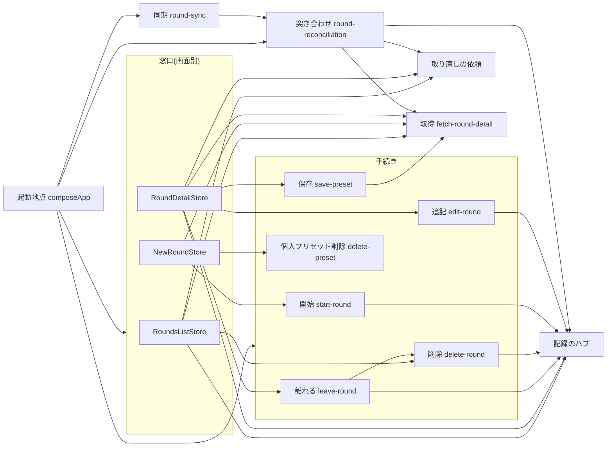

# rounds 共通設計

## 概要

一覧・作成・詳細・同期が共有する構造と、機能ごとに別の言い方にしない判断を書く。
機能ごとの画面と流れは、各機能の`design.md`に従う。構造の方針は`docs/architecture.md`に従う。
画面へ状態と変更の方法を渡す入口(窓口)は画面ごとに3つ(`RoundsListStore`、`NewRoundStore`、`RoundDetailStore`)で、手続きは画面に属し、記録のハブは1つで、同期は同期からラウンドへの一方向である。
複数の画面で使う`whenOnline`は3つの窓口が同じ契約で持ち、共有フック`useFetchResult`は窓口を知らずに引数で受ける。
起動地点は層までのパスで各層の生成関数を取り込む(`docs/architecture.md`第5節の参照の書き方)。

## 構造図

認証、接続、時計、データベースは図の外の入力である。

## 構成

### 窓口のメンバー

一覧の窓口`RoundsListStore`(`features/rounds/application/rounds-list-store.ts`)

| メンバー | 内容 | 委譲先・実装 |
| --- | --- | --- |
| `loadList()` | 一覧の取得と一括の取得の依頼を並行に行い、削除の印を反映して一覧の材料を返す。`FETCH_TIMEOUT_MS`で打ち切る | 窓口内、`fetching.fetchRoundsList`、`requests`、`hub` |
| `loadLocalList()` | 端末の入力中のラウンドの一覧 | 窓口内 |
| `deleteRound(roundId)` | 削除を積み、画面に残る。保存の試みが終われば解決し、拒否しない | `deletion.deleteRound` |
| `afterFallbackWait(listener)` | `FALLBACK_WAIT_MS`後に1回呼ぶ。返す関数で取り消す。使い手は一覧だけ | `clock.after` |
| `whenOnline(listener)` | 共有表のとおり | `when-online.ts` |

作成の窓口`NewRoundStore`(`new-round-store.ts`)

| メンバー | 内容 | 委譲先 |
| --- | --- | --- |
| `loadPresets()` | プリセット(個人と公式)の取得。取得できれば保存し、できなければ保存済み | `fetching.fetchPresets` |
| `startRound(preset, isCurrent)` | 作成を積み、保存の完了の後に詳細へ進む | `roundStart.startRound` |
| `deletePreset(presetId, isCurrent)` | 個人プリセットの削除 | `presetDeletion.deletePreset` |
| `whenOnline(listener)` | 共有表のとおり | `when-online.ts` |

詳細の窓口`RoundDetailStore`(`round-detail-store.ts`)

| メンバー | 内容 | 委譲先・実装 |
| --- | --- | --- |
| `load(roundId)` | 開く材料。`FETCH_TIMEOUT_MS`で打ち切る | 窓口内、`requests.open` |
| `round(roundId)` | 購読と操作の追記を持つ`RoundHandle`(ラウンドごとに1つ) | `round-handle.ts` |
| `completeRound(roundId)` | 完了を積み、保存の後に一覧へ進む | `leaving.completeRound` |
| `deleteRoundAndLeave(roundId)` | 削除を積み、保存の後に一覧へ置き換えて移る | `leaving.deleteRoundAndLeave` |
| `leaveRound()` | 一覧へ置き換えて移る | `leaving.leaveRound` |
| `savePreset(preset)` | 現在の構成のプリセットの保存 | `presetSaving.savePreset` |
| `newId()` | 新しいID(イベントID、距離のID) | `ids.next` |
| `newShotId(endShotIds)` | そのエンドの既存の矢より後ろに並ぶ時刻順の矢のID | `shotIdAfter` |
| `whenOnline(listener)` | 共有表のとおり | `when-online.ts` |

複数の画面で使うメンバー

| メンバー | 使い手の画面 | 置き場 | 理由 |
| --- | --- | --- | --- |
| `whenOnline` | 一覧、作成、詳細(`use-fetch-result.ts`が各画面の窓口の関数を引数で受ける) | 3つの窓口が同じ契約で持つ。実装は`application/when-online.ts`の1つ | 第4の窓口を作らず、共有フックが窓口に依存しない。契約と挙動は1か所 |
| 窓口の文脈(`ui/rounds-context.tsx`) | 3画面 | 画面ごとに別の文脈(Providerとhookを各窓口に1つずつ) | 画面は自分の窓口だけを取り出せる。テストは使う窓口だけを渡す |

使い手のないメンバー`append`(窓口の直接の追記)は持たない。追記は`round(roundId).append`が手続き`edit-round.ts`を通して行う。
窓口の生成は、状態を持たない部分をモジュール関数に出し、deps(受け取る手続きと部品)を引数で受ける。状態を閉じ込める`createRoundHandle`(`round-handle.ts`)だけが関数の長さの例外を持つ。

### UI層のファイルと画面の対応

| 画面 | ファイル | 窓口(hook) |
| --- | --- | --- |
| 一覧 | `rounds-list.tsx`、`use-local-rounds-list.ts` | `useRoundsListStore` |
| 作成 | `round-preset-select.tsx`、`use-start-round.ts`、`use-preset-delete.ts` | `useNewRoundStore` |
| 詳細 | `round-detail-client.tsx`、`use-creation-gone.ts`、`use-round-op-stack.ts`、`use-scorecard.ts`、`use-shot-input.ts`、`use-distance-editing.ts`、`distance-edit-fields.tsx`、`round-config-panel.tsx`、`round-menu.tsx`、`save-preset-dialog.tsx` | `useRoundDetailStore` |
| 詳細(窓口を使わない) | 上以外の`ui/`のファイル(`scorecard-client.tsx`、`round-summary-bar.tsx`、`end-row.tsx`、`keypad-panel.tsx`ほか) | なし(propsで値と関数を受ける) |
| 複数画面 | `use-fetch-result.ts`、`fetch-state.tsx` | なし(`use-fetch-result.ts`は`whenOnline`を引数で受ける) |
| 複数画面 | `preset-info.tsx`、`target-face-info.tsx` | なし(表示だけ。作成と詳細が使う) |
| 複数画面 | `rounds-context.tsx` | 3つの文脈を定義 |

`round-config-panel.tsx`と`round-config-card.tsx`は詳細(スコアカードの設定の節)、`save-preset-dialog.tsx`は詳細(スコアカードのヘッダー)に属する。
`features/round-sync/ui/round-base-refresher.tsx`は画面に属さない(同期の契機を渡す常駐の部品)。

### 起動地点の組み立て

起動地点(`app/root-client-entry.tsx`)は、責務ごとの4つの関数を呼んで結ぶ。入力(認証、識別情報の保存、接続、時計、データベース、遷移)、記録と取得(ハブ、依頼の記録、取得、突き合わせ)、窓口(手続きと3つの窓口)、同期(同期と契機)。

| 部品 | 受ける部品(注入) |
| --- | --- |
| 削除の手続き`RoundDeletion` | ハブ、ID |
| 離れる手続き`RoundLeaving` | ハブ、ID、遷移、削除の手続き |
| 追記の手続き`RoundEditing` | ハブ、ID |
| 開始の手続き`RoundStart` | ハブ、サインインの読み手、ID、時計、遷移 |
| 個人プリセット削除の手続き | サインインの読み手、命令、保存済み |
| 保存の手続き | サインインの読み手、命令、取得 |
| 一覧の窓口 | ハブ、依頼の記録、取得、時計、接続、削除の手続き |
| 作成の窓口 | 取得、開始の手続き、個人プリセット削除の手続き、接続 |
| 詳細の窓口 | ハブ、依頼の記録、取得、時計、接続、ID、離れる手続き、追記の手続き、保存の手続き |

一覧と詳細の窓口は同じ依頼の記録を受ける(詳細と一覧の取得の依頼が同じ記録を共有するため。`round-sync.integration.test.ts`が検証する)。
3つの文脈は入れ子にして`children`を包む。同期と契機の組み立ては窓口と無関係である。

### 窓口に関わるファイル

- `features/rounds/application/`: `rounds-list-store.ts`、`new-round-store.ts`、`round-detail-store.ts`(窓口)、`round-handle.ts`(開いた詳細の購読と追記)、`when-online.ts`(通信の復帰の合図)、`delete-round.ts`(画面に残る削除)、`leave-round.ts`(完了、削除して離れる、一覧へ戻る)、`time-limit.ts`(`withinFetchTimeout`を持つ)。
- `features/rounds/ui/`: `rounds-context.tsx`(3つの文脈)、`use-fetch-result.ts`(`whenOnline`を引数で受ける)。

## 命名の規則

1. ファイル名の`-types`は、型だけを持つファイルに限る。`-constants`は、定数だけを持つファイルに限る。関数(規則)を持つファイルには付けず、概念の名前にする(`preset.ts`、`round-config.ts`、`target-face.ts`)。
2. 手続きの約束・ドメインの約束のファイルは、約束の名前で呼ぶ(`navigation.ts`、`unique-ids.ts`)。型だけでも`-types`を付けない。

該当ファイルの検査: `features/rounds`と`features/round-sync`の全層から`*types*`、`*constants*`、`*-type.ts`を探すと、`domain/scorecard-types.ts`、`domain/round-constants.ts`、`infrastructure/reference-query-constants.ts`が該当し、いずれも型だけ、定数だけで適合する。型と関数を持つ`domain/target-face.ts`は、概念の名前で呼ぶ。アプリケーション層、UI層、`round-sync`に該当する名前のファイルは無い。

## テスト補助の置き場の規則

1. 名前は`<対象>-test-helpers.ts`。補助自体が論理を持つなら同名の`.test.ts`を置く(ファイルごとの網羅閾値のため)。
2. 業務の言葉を持たない技術の約束の偽物(時刻、通信の可否、端末の保存)は、`lib/<能力>/`に置き、機能が共有する。
3. 業務の言葉を持つ補助は、その業務を持つ機能の中に置く。置く層は、使うテストの層のうち最も内側の層(1つの層だけが使うならその層、複数の層が使うなら最も内側の層。機能の直下には置かない)。
4. 他の機能のテストが、持ち主の機能の補助を使ってよい(`round-sync`のテストが`rounds`の補助を使う)。補助を機能の入口(`index.ts`)へ出さない。
5. 同じ契約の偽物を複数のテストが別々に定義しない。契約ごとに1つを、規則2または3の置き場に置く。置き換えない場合は、挙動の差を理由に記す。

| ファイル | 使い手の層 | 規則 |
| --- | --- | --- |
| `lib/clock/manual-clock-test-helpers.ts`、`lib/connectivity/fake-connectivity-test-helpers.ts`、`lib/local-op-log/memory-op-log-store-test-helpers.ts` | 共有 | 2 |
| `rounds/domain/round-op-test-helpers.ts` | domain、application、infrastructure、ui、app、round-sync | 3(最も内側=domain) |
| `rounds/application/round-record-test-helpers.ts`、`fake-sign-in-reader-test-helpers.ts`、`fake-navigation-test-helpers.ts`、`fake-unique-ids-test-helpers.ts` | application、ui、round-sync/application | 3(最も内側=application) |
| `rounds/ui/round-stores-test-helpers.ts` | ui | 3 |
| `round-sync/application/op-sender-test-helpers.ts` | round-sync/application | 3 |

重複していた偽物の扱い

| 契約 | 扱い |
| --- | --- |
| `SignInReader` | `fake-sign-in-reader-test-helpers.ts`へ置き換える(`fetch-content`、`fetch-round-detail`、`start-round`、`save-preset`、`delete-preset`) |
| `Navigation` | `fake-navigation-test-helpers.ts`へ置き換える(`leave-round`、`start-round`) |
| `UniqueIds` | `fake-unique-ids-test-helpers.ts`へ置き換える(`leave-round`、`start-round`、`edit-round`、`delete-round`、`round-record-test-helpers.ts`、`round-sync.integration.test.ts`) |
| `Connectivity` | `lib`の`createFakeConnectivity`へ置き換える(`fetch-round-detail`)。置き換えない箇所は次の2つ |
| 置き換えない: `fetch-content.test.ts` | 取得の途中で購読者へ知らせずに切断の状態だけを替える検証(HTTP応答のあるエラーはerrorのまま、時間切れはofflineを返す、など)があり、`createFakeConnectivity`は状態を替えると必ず購読者へ知らせるため、同じ検証にならない |
| 置き換えない: `sync-triggers.test.ts` | `onOnline`と`onOffline`を購読した依頼の回数と、解除後の購読数を別々に検証する。`createFakeConnectivity`は有効な購読数だけを持ち、依頼した回数は持たない |
| `Clock` | 独自の定義は無い(全テストが`createManualClock`) |

`ui/scorecard-client.test.tsx`のルーターの差し替えは`next/navigation`の差し替えで、`Navigation`を満たす値ではないため対象外である。

## 設計判断

| 判断 | 理由 | 見直す条件 |
| --- | --- | --- |
| 窓口を画面別に分け、複数画面の`whenOnline`は各窓口が同じ契約で持つ | 画面ごとに必要な委譲だけが見え、偽物が小さく、共有フックが窓口に依存しないため。共有の第4の窓口は、節点が増え使い手の少ない窓口になるため採らない | 4つ目の画面が同じ取得の状態を使うとき |
| 操作のIDは詳細の窓口が払い出す | 操作を組み立てるのは詳細の画面だけで、一覧の削除と作成の開始は手続きが払い出すため。操作の組み立てを手続きへ移す案は、同じ操作を表す型が2つになり、指す矢と履歴の持ち主が画面と手続きに分かれるため採らない | 操作の組み立てを全て手続きへ移すとき |
| 削除は一覧の窓口の`deleteRound`(画面に残る)と詳細の窓口の`deleteRoundAndLeave`(離れる)に分け、手続きも`delete-round.ts`と`leave-round.ts`に分ける | 各窓口に削除が1つになり、他画面の削除を指す注記が要らなくなるため。手続きを分けない案は、一覧が「離れる手続き」の削除を引き、手続きの責務の説明が画面と合わないため採らない | 一覧と詳細の削除の手続きが同じ変更を受け続けるとき |
| 起動地点は層までのパスで各層の生成関数を取り込む | `docs/architecture.md`第5節の参照の書き方(組み立て層は入口を経由しない)に従うため | 規則が変わったとき |
| テスト補助は使う層のうち最も内側の層に置く | 参照の向きを依存の向きに合わせ、補助が使い手より外側の層に置かれて層が不明になることを避けるため | テストの置き場の方針が変わったとき |
